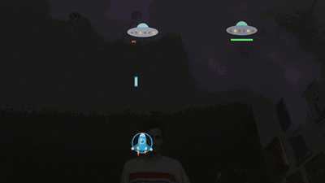

# head-invaders

**Head Invaders is a free video game for children which they play by moving their whole body in front of a webcam, instead of sitting still with a controller.**

Each player in front of the camera gets a spaceship, which follows their head.
To fly, you move: step left and right, duck and stretch up to dodge the projectiles, and catch the falling boosters.
The spaceships fire all by themselves, so there are no buttons to learn.
Friends can join or leave at any time, just by stepping in front of the camera or away from it.

Bad dreams have invaded your head, and you chase them away through ten worlds: from outer space over the forest, the sea, the lava, the desert, the ice, the sky and the Swiss Alps all the way home to Zurich.
Each world has its own creatures, treasure chests to shoot open, and a big boss at the end.

The game is made for children.
Nothing in it is violent: the defeated creatures only get dizzy and fly home, and a spaceship which runs out of shield simply tries the level again.
Everything is big and bright, so that you can play on a laptop from a couple of meters away.

**No network access.**
The game runs entirely on your computer and works offline.
It never connects to any server: the webcam images are processed locally, in memory, and are never saved or sent anywhere.
There are no accounts, no ads, no analytics and no telemetry.

## Download

Download the game for Linux, Windows or macOS from the [releases].
Unzip the package and start the game.
You need a webcam which supports 640x480 in the YUYV format.

The macOS package runs on Apple Silicon.
On Intel Macs, the head tracking does not work, since ONNX Runtime provides no library for them.

[releases]: https://github.com/mristin/head-invaders/releases

## Acknowledgments

We track the heads with the following models (each model directory contains its license):

* [YOLOX-Body-Head-Hand-Face] (nano, 256x320, Apache-2.0) detects the whole heads from any side, and the bodies.
* [OSNet] (x0.25, trained on MSMT17, MIT) recognizes the players when they come back.
  Note that the MSMT17 dataset itself is licensed for research only.
* [UltraFace] (RFB-320, MIT) detects frontal faces; we keep it as a faster fallback.

[YOLOX-Body-Head-Hand-Face]: https://github.com/PINTO0309/PINTO_model_zoo/tree/main/434_YOLOX-Body-Head-Hand-Face
[OSNet]: https://github.com/KaiyangZhou/deep-person-reid
[UltraFace]: https://github.com/Linzaer/Ultra-Light-Fast-Generic-Face-Detector-1MB

The structure of the game, the camera set-up and the inference loop were adapted from [ergo-chaos].

[ergo-chaos]: https://github.com/mristin/ergo-chaos

## License

Head Invaders is licensed under the [MIT License](LICENSE).
The third-party components, e.g., Godot Engine, ONNX Runtime and the head-tracking models, keep their own licenses; see [THIRD_PARTY_NOTICES.md](THIRD_PARTY_NOTICES.md).

## Contributing

See [CONTRIBUTING.md](CONTRIBUTING.md) for how to set up the development environment, how to test the levels in isolation, and how to run the formatter, the linter and the tests.

## Changelog

### 1.0.0 (2026-11-07)

The first version which was playable and fun back-to-back.
